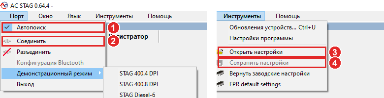
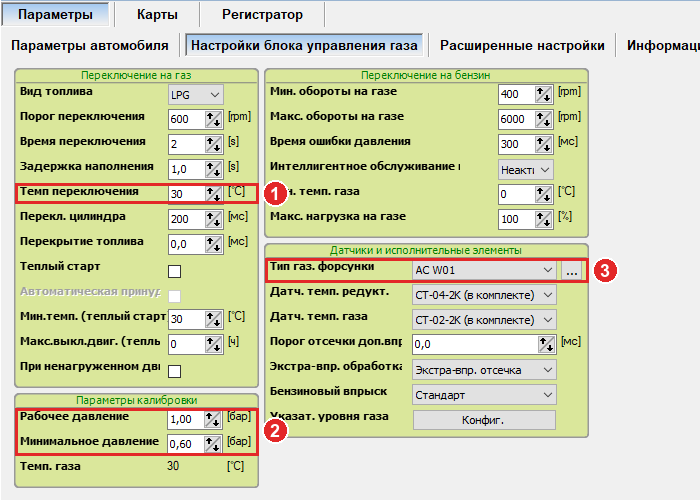
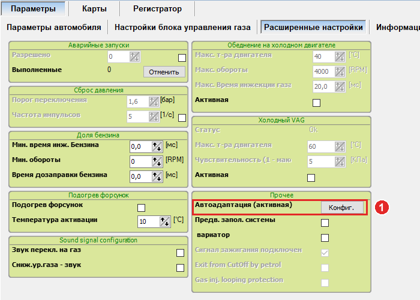
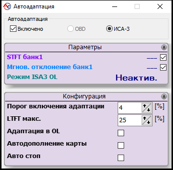
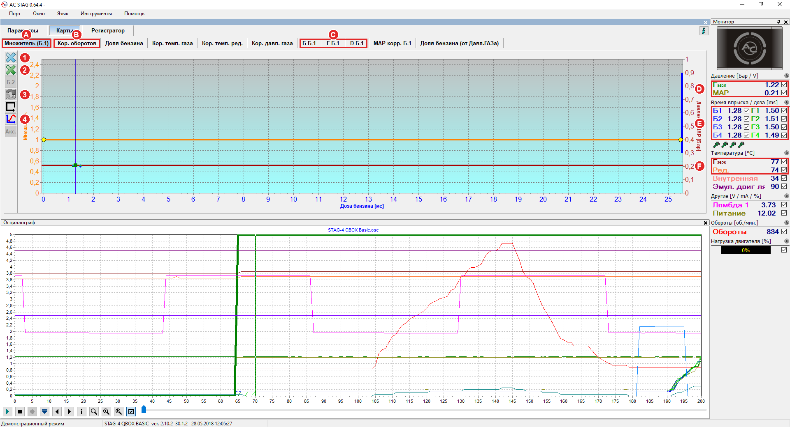
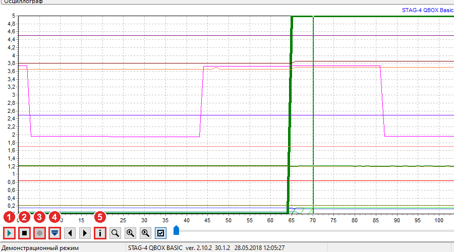

# AC STAG: що і куди натискати (STAG-4 QBOX BASIC / STAG-300 QMAX BASIC)

Джерела:
- мануал `docs/stag/STAG-4 QBOX,QNEXT,STAG-300 QMAX - Manual_ver1_7_11[2022-12-30]_EN.pdf` (розділи 2–3);
- **реальний інтерфейс AC STAG 0.64.4** у демо-режимі `STAG-4 QBOX Basic` (прошивка 2.10.2):
  скріншоти в `docs/img/acstag_demo/`. Інтерфейс російською (української локалі в AC STAG немає).

> **Що важливо знати про BASIC**
> - OBD-рідера немає → STFT/LTFT сам Stag не бачить, їх дає тільки наш ELM327-логер.
> - **Автоадаптація ISA-3 у BASIC Є** (у мануалі написано «лише PLUS», але прошивка 2.10.x її має).
>   Вона підтягує дозу газу під **бензинову карту Б**. Завтра треба глянути, чи вона ввімкнена у вас
>   (розділ 3).
> - Stag дає своє: час впорску бензину **Б1–Б4**, дозу газу **Г1–Г4**, тиск газу, MAP, температури,
>   карти **Б / Г / D**, множник.

---

## 0. Підготовка (вдома, один раз)

1. **Кабель Stag (USB)** — у Диспетчері пристроїв має з'явитися `USB Serial Port (COMx)`.
   Якщо «невідомий пристрій» — потрібен драйвер FTDI/CP210x (скажете, підкажу).
2. **ELM327** — див. `02_drive_plan.md`, «Спарювання».

## 1. Підключення до контролера

1. **Запалювання ON** (контролер засинає через ~10 хв без живлення).
2. Запустити AC STAG. Меню **Порт**: галочка **Автопоиск** ① має стояти (порт шукається сам,
   вибирати COM вручну не треба). Якщо не підключилось саме — **Порт → Соединить** ②.
3. Успіх = внизу ліворуч замість червоного **«Отсутствие соединения»** з'являється
   `Бензин` / `Газ` / `Ожидание газа`, а поруч — **модель і прошивка** (у демо:
   `STAG-4 QBOX BASIC ver. 2.10.2`). **Сфотографувати/записати.**

## 2. ПЕРШ НІЖ ЩОСЬ МІНЯТИ — резервна копія (щоб не загубити газову карту)

**Що саме «газова карта».** Дозу газу визначає **Множитель (Б-1)** (помаранчева лінія, вкладка
**Карты**) плюс поправки: **Кор. оборотов**, **Кор. темп. газа**, **Кор. темп. ред.**, **Кор. давл. газа**,
**MAP корр. Б-1**. Якщо ввімкнена ISA-3 — ще й **карта Б** (еталон для автоадаптації). Усе це треба берегти.

Три рівні захисту — робити всі три:

1. **Файл налаштувань** — **Инструменты → Сохранить настройки** ④ → зберегти у
   `C:\Projects\TotyotaLpgCalibration\stag\backup\` з датою в назві (`2026-09-26_original`).
   Друга копія — на флешку/в хмару. (Пункт активний лише при підключеному контролері; у демо він сірий.)
2. **Окремої кнопки «зберегти карту у файл» у BASIC немає** — я перевірив усі вкладки карт у демо.
   Тож файл налаштувань — єдина «цифрова» копія, і тому обов'язково ще й пункт 3.
3. **«Паперова» копія** — скріншот (Win+Shift+S) кожної вкладки карт і таблиця множника:
   на **Множитель (Б-1)** клікати по черзі жовті точки → значення видно в правому нижньому куті →
   записати «мс → множник». Скріншоти таблиць **Кор. оборотов** (час впорску × оберти — корекції
   на високих обертах, якщо майстри щось туди вписували), **MAP корр. Б-1** (тут пише ISA-3) і
   **Доля бензина** (дотриск бензину на високих обертах/навантаженні) — там видно цифри.
   Навіть без файлу за цим можна відновити все вручну.

Плюс скріншоти всіх підвкладок **Параметры** і **Помощь → Информация о блоке управления**
(час роботи на газу/бензині, дати змін). Усе — у `stag/screens/`.

**Перевірка копії** (вдома, не посеред поїздки): **Инструменты → Открыть настройки** ③ → відкрити
збережений файл → переконатися, що множник той самий. Відкриття файлу **нічого не записує в
контролер**, але розриває зв'язок із ним (програма попередить) — тому в кінці.

> За мануалом, множник правиться «наживо» (стрілками просто під час їзди), окремої кнопки
> «записати в контролер» там немає. Тож вважаємо, що кожне натискання одразу міняє налаштування.
> Копію робимо **до** першого руху будь-якої точки, а після калібровки — ще одну.

## 3. Параметри: що записати

**Параметры → Настройки блока управления газа**: ① **Темп переключения** (при якій температурі
редуктора переходить на газ), ② **Рабочее давление / Минимальное давление** (у демо 1,00 / 0,60 бар;
робоче не міняти — після нього треба перекалібровувати множник), ③ **Тип газ. форсунки**.

**Перевірка «чи крутили редуктор»:** на прогрітих холостих на газу глянути «Газ» у Мониторі
(це різниця редуктор − колектор) і порівняти з ② «Рабочее давление». Різниця > 0,1 бар = тиск на
редукторі міняли без оновлення налаштування (у демо, до речі, 1,22 проти 1,00). Записати обидва
числа — аналізатор порівняє їх по всій поїздці: `analyze.bat --work-pressure 1.00`.

**Параметры → Расширенные настройки → Прочее**: ① **Автоадаптация (активная)** + кнопка **Конфиг.** →
відкриває вікно ISA-3 (воно ж може вискочити саме при підключенні):

Записати: **Включено** так/ні, режим **ИСА-3**, **Порог включения адаптации**, **LTFT макс.**,
галочки. Поля **STFT банк1** і **Мгнов. отклонение банк1** — це поточна корекція ISA-3 у %; їх варто
тримати ввімкненими в осцилографі. **На першу поїздку нічого тут не міняємо**, лише записуємо.

## 4. Вкладка Карты

Підвкладки: Ⓐ **Множитель (Б-1)** — головна карта калібровки; Ⓑ **Кор. оборотов** — поправка
множника залежно від обертів; Ⓒ **Б Б-1 / Г Б-1 / D Б-1** — 3D-карти часу впорску на бензині (Б),
на газу (Г) і їхнє відхилення (D, у % — **додатне = на газу багато**).

Іконки ліворуч від множника (підписи — зі спливних підказок програми):

| # | Підказка | Що робить | |
|---|---|---|---|
| ① | **Удалить B** | стирає бензинову карту | **⛔ не натискати** (при ISA-3 це еталон) |
| ② | **Удалить G** | стирає газову карту | **⛔ не натискати** без потреби |
| — | Переключить банк 1 / банк 2 | для V-подібних; у нас неактивна | |
| ③ | Подбор множителя (при ISA-3 підказка «ИСА-3 включена — соответствия неактивны») | автопідбір множника за картами Б/Г | не натискати |
| — | Автоматический выбор | точка множника біля курсора стає активною сама | |
| ④ | **Отклонение** | показує червону лінію відхилення Б vs Г | безпечно, корисно |
| — | Выбор единицы измерения | одиниці осей | |

На **Кор. оборотов** теж є іконка **«Удалить»** (хрестик) — не натискати; шестірня — «Конфигурация
карты» (лише межі осей).

Правий монітор: Ⓓ **Газ / MAP** (тиск газу; у демо на холостих 1,22 бар при MAP 0,21),
Ⓔ **Б1–Б4 / Г1–Г4** — час впорску бензину / доза газу в мс (у демо 1,28 → 1,50, тобто множник ≈1,17),
Ⓕ температура **газу** і **редуктора**.

**Швидкий ручний тест калібровки (мануал 3.5):** рівна їзда, стале навантаження (найвища передача,
70–90 км/год). Запам'ятати **Б1** на бензині → перемкнути на газ → через 20–30 с глянути **Б1** знову.
- **Б стало менше** → на газу багато, множник у цій точці **завеликий**.
- **Б стало більше** → на газу бідно, множник **замалий**.
- Однаково (±3–5 %) → у цій точці калібровка добра.
(Якщо ввімкнена ISA-3, вона сама підтягує різницю — дивитись ще й «Мгнов. отклонение банк1».)

## 5. Осцилограф — запис поїздки

Кнопки внизу (підписи — з підказок програми): ① **Старт диаграммы**, ② **Стоп диаграммы**,
③ **Запись диаграммы** (зберегти у файл `.osc`), ④ **Считывание диаграммы** (відкрити файл),
⑤ **Информация о файле**. Далі — масштаб, пошук, «Отобразить/скрыть все параметры».

1. На старті поїздки: ① (одночасно із запуском ELM-логера).
2. Зелена лінія зверху = контролер працює **на газу**.
3. Клік по назві сигналу в Мониторі — вимкнути/увімкнути його в осцилографі. Лишити: Обороты, MAP,
   Б1, Г1, Газ (тиск), Ред., Газ (темп.), Нагрузка, Лямбда 1 (+ STFT банк1 / Мгнов. отклонение, якщо ISA-3).
4. **Зберігати кожні 15–20 хв**: ② → ③ у `stag/osc/` → ①. Назви: `2026-09-26_01_warmup.osc` і т.д.
5. Ці файли наш аналізатор читає сам (формат розібрано — `stag/osc_format/FORMAT.md`) і зводить
   з ELM-логом за часом. Перегазовки на старті лишаємо як контроль синхронізації.

## 6. План щодо карт на першу поїздку

**Нічого не очищаємо і не рухаємо.** Лише скріншоти (Множитель з кнопкою «Отклонение», Б, Г, D).
Контролер сам допише нові точки в карти під час їзди. Основне порівняння газ/бензин дасть ELM-лог.

## 7. Чого НЕ робити без аналізу

- Не натискати **Удалить B / Удалить G / Удалить** на картах.
- Не запускати **автокалибровку** (перезапише множник) і не міняти **Рабочее давление**.
- Не міняти налаштування ISA-3.
- **Инструменты → Вернуть заводские настройки** — ніколи.
- Не стирати помилки (вкладка з помилками в BASIC-демо не показується; якщо у вашому блоці є —
  лише скріншот).

## 8. Після поїздки — калібровка (наступний етап)

1. Порівнюємо: ELM-лог (STFT+LTFT газ vs бензин по обертах×навантаженню) + карта **D Б-1** + записи Б/Г.
2. Зони з розбіжністю → переводимо у «час впорску Б, мс» → коригуємо точки **Множитель** стрілками ↑/↓
   (Shift = крок ×10; Insert — додати точку; Space під час їзди — вибрати точку біля курсора).
   Малими кроками (2–3 %).
3. Контрольна поїздка з логером → різниця трімів газ/бензин < 3 п.п.
4. Нова копія: **Инструменты → Сохранить настройки** → `stag/backup/2026-xx-xx_after_cal`.
